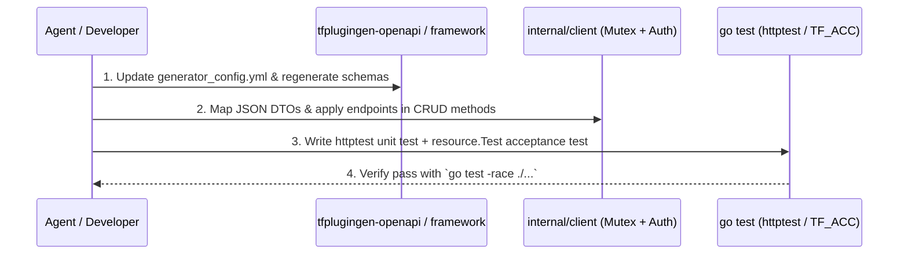

# 🤖 AGENTS.md — AI Coding Agent Guidelines

## 🎯 Project Context

This repository implements a custom Terraform provider (`pfsense-nexus`) in Go using `://github.com`. It wraps Netgate's official Go-based REST API (`docs/nexus.openapi.yaml`) for pfSense 26.07+ and 26.10+.

## 📐 Architectural Rules & Constraints

1. **Never Bypass `NexusClient.DoRequest`:** All HTTP calls to pfSense MUST route through `internal/client.NexusClient.DoRequest()`. This method enforces a `sync.Mutex` lock so concurrent Terraform goroutines execute sequentially against pfSense's configuration backend.
2. **Preserve Generated Files vs. Custom Logic:**
   - Files emitted by `tfplugingen-framework` into `internal/provider/` define schemas and models. When regenerating from `generator_config.yml`, verify that custom `Create`/`Read`/`Update`/`Delete` wiring and `ImportState` methods are preserved.
3. **Explicit Apply / Reload Lifecycle:**
   - If an endpoint in `docs/nexus.openapi.yaml` stages changes without immediately activating them (e.g., firewall rules, NAT, Unbound DNS), trigger the corresponding `/apply` endpoint at the end of `Create`, `Update`, and `Delete`.
4. **Strict Secret Handling:**
   - Any field holding keys, passwords, PSKs, or tokens (`private_key`, `preshared_key`, `password`, `tls_key`) MUST have `Sensitive: true` in its `schema.StringAttribute`.
   - If a `GET` endpoint masks or omits a secret value, `Read()` MUST retain the existing `state` value rather than overwriting it with an empty string.
5. **Graceful 404 Handling in `Read()`:**
   - When the Nexus API returns `HTTP 404 Not Found` during `Read()`, call `resp.State.RemoveResource(ctx)` and return without adding an error diagnostic so Terraform detects out-of-band deletion cleanly.

## 🔄 Standard Development Workflow

Use pnpm for JavaScript-based repository tooling. The repository `.npmrc`
disables package installation scripts; do not override this setting. Run
required project scripts explicitly with `pnpm run`.

## ✅ Definition of Done for Any New Resource

Before marking a resource complete, verify:

- [ ] Endpoint paths and JSON field tags match `docs/nexus.openapi.yaml`.
- [ ] `Create`, `Read`, `Update`, `Delete`, and `ImportState` are all implemented.
- [ ] Sensitive fields are marked `Sensitive: true`.
- [ ] Offline unit test in `internal/client` or `internal/provider` passes under `go test -race ./...`.
- [ ] No hardcoded credentials, IPs, or private keys appear in code or examples.
