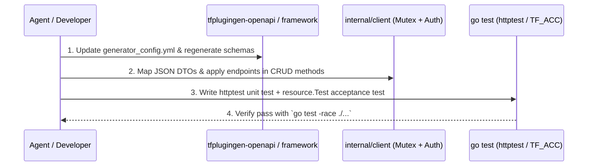

# 🤖 AGENTS.md — AI Coding Agent Guidelines

## 🎯 Project Context

This repository implements an experimental Terraform provider in Go, published
as `geo-gaussian/pfsense-nexus`. It wraps the Nexus API described in
`docs/nexus.openapi.yaml`. Alias listing has been tested on one appliance;
write operations and compatibility with other versions remain unverified.

## 📐 Architectural Rules & Constraints

1. **Never Bypass `NexusClient.DoRequest`:** All HTTP calls to pfSense MUST route through `internal/client.NexusClient.DoRequest()`. Its mutex serializes HTTP requests per configured client, not across separate clients or Terraform processes.
2. **Preserve Generated Files vs. Custom Logic:**
   - Files emitted by `tfplugingen-framework` into `internal/provider/` define schemas and models. When regenerating from `generator_config.yml`, verify that custom `Create`/`Read`/`Update`/`Delete` wiring and `ImportState` methods are preserved.
3. **Explicit Apply / Reload Lifecycle:**
   - If an endpoint in `docs/nexus.openapi.yaml` stages changes without immediately activating them, trigger its corresponding apply or reload operation after `Create`, `Update`, and `Delete`. The alias resource initiates a filter reload but does not confirm completion.
4. **Strict Secret Handling:**
   - Any field holding keys, passwords, PSKs, or tokens (`private_key`, `preshared_key`, `password`, `tls_key`) MUST have `Sensitive: true` in its `schema.StringAttribute`.
   - If a `GET` endpoint masks or omits a secret value, `Read()` MUST retain the existing `state` value rather than overwriting it with an empty string.
5. **Graceful 404 Handling in `Read()`:**
   - When the Nexus API returns `HTTP 404 Not Found` during `Read()`, call `resp.State.RemoveResource(ctx)` and return without adding an error diagnostic so Terraform detects out-of-band deletion cleanly.
6. **POSIX Shell Scripts:**
   - Project-owned shell scripts MUST use POSIX shell syntax and `#!/bin/sh`. Spec Kit-managed scripts are temporarily exempt.
7. **No Inline Programs:**
   - Store executable code, configuration used as a program, and test fixtures in standalone files in their own language. Pass dynamic values as arguments, environment variables, or supported configuration variables. Do not embed programs in shell commands, workflow blocks, other languages' strings, or agent terminal commands.
   - This includes interpreter `-c`/`-e` code and inline AWK, sed, and jq programs. Ordinary commands and arguments are allowed.
   - Spec Kit-managed scripts under `.specify/scripts/` are exempt. No other automatic exception applies, including tests and generated fixtures: obtain the user's explicit approval before adding any other exception.
   - Short, syntax-highlighted documentation examples may explain a concept; reusable automation belongs in standalone files.

## 📝 Documentation Rules

- Markdown headings at levels 1, 2, and 3 MUST include a relevant emoji.
- Use two-space indentation in Markdown and preserve rendered list and code
  block structure.
- Follow the repository's cspell configuration and update documentation when
  behaviour or development workflows change.
- Keep examples free of credentials and other sensitive information.

## 🔄 Standard Development Workflow

Use pnpm for Node-based repository tooling. The repository `.npmrc`
disables package installation scripts; do not override this setting. Run
required project scripts explicitly with `pnpm run`.

## ✅ Definition of Done for Any New Resource

Before marking a resource complete, verify:

- [ ] Endpoint paths and JSON field tags match `docs/nexus.openapi.yaml`.
- [ ] `Create`, `Read`, `Update`, `Delete`, and `ImportState` are all implemented.
- [ ] Sensitive fields are marked `Sensitive: true`.
- [ ] Offline unit test in `internal/client` or `internal/provider` passes under `go test -race ./...`.
- [ ] No hardcoded credentials, IPs, or private keys appear in code or examples.
