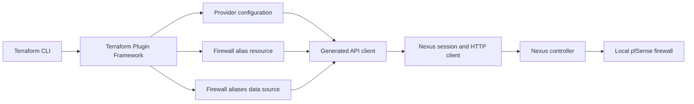

# 🏗️ Architecture

## 🎯 Scope and status

This experimental Terraform provider manages a local pfSense firewall through
the Nexus controller API. Its provider source is
`geo-gaussian/pfsense-nexus`; the local Terraform provider name is `pfsense`.
It currently offers:

- `pfsense_firewall_alias`: create, read, update, delete, and import an alias.
- `pfsense_firewall_aliases`: read user-defined alias metadata without changing
  aliases or reloading the firewall.

Login and alias listing have been exercised on one appliance. Alias writes and
reloads have only been tested against mock servers. Do not use the write
resource on a production firewall until it has been validated in an isolated
environment.

## 🧩 Components

| Component | Responsibility |
| --- | --- |
| [main.go](main.go) | Starts the provider server and exposes its version. |
| [internal/provider/provider.go](internal/provider/provider.go) | Defines configuration, registers the resource and data source, and supplies their API client. |
| [Alias resource](internal/provider/resource_firewall_alias/firewall_alias_resource.go) | Maps Terraform state and plans to API requests, handles import and missing aliases, and initiates firewall reloads. |
| [Aliases data source](internal/provider/data_firewall_aliases/firewall_aliases_data_source.go) | Reads alias metadata and reports missing or invalid responses. |
| [internal/api/client_gen.go](internal/api/client_gen.go) | Generated API types, request builders, and response parsers. |
| [internal/client/client.go](internal/client/client.go) | Validates the controller URL, manages authentication, and serializes HTTP requests. |

Terraform communicates with the provider using the Plugin Framework. The
Registry manifest declares protocol version 6. The provider creates an API
client for `/api/device/pfsense/localhost/api`, assuming the local firewall is
registered as `localhost`. That routing assumption has not been verified across
other installations.

## 🔐 Authentication and request flow

The provider requires an HTTPS origin, username, and password. TLS verification
is enabled by default; `insecure` disables certificate verification and is for
isolated tests only. The password is marked sensitive, but Terraform state and
saved plans can still contain sensitive information and must be protected.

Authentication is lazy: the first API operation logs in through
`/api/login`, and later operations refresh the session through
`/api/login/refresh` when renewal is due. The client maintains a cookie jar and
sends the access token as a bearer token. A plan for a new resource does not
necessarily contact the controller.

All HTTP calls, including login and refresh, pass through `NexusClient.DoRequest`.
Locks serialize session handling and individual HTTP requests for a configured
client. They do not make a whole CRUD operation atomic, coordinate separate
provider configurations or Terraform processes, or prevent external changes.

## 🔄 Alias lifecycle

The alias name is the Terraform identity and import identifier; changing it
requires replacement. The resource uses `PUT /aliases` to create,
`GET /aliases/{id}` to read, `POST /aliases/{id}` to update, and
`DELETE /aliases/{id}` to delete.

After a successful write, the provider initiates a filter reload with
`POST /system/filterreload/reload` and verifies the alias through a read. It
does **not** wait for reload completion or prove that the rules are active.
If a write or reload fails, inspect the firewall and reload manually before
retrying; state refresh may observe the change without retrying the reload.
An uncertain create response may require importing the existing alias.

A read removes the resource from Terraform state when the API confirms the
alias is absent. If the API returns HTTP 400, the provider checks the alias
list before treating it as absent. It rejects truncated alias details rather
than saving incomplete resource state. The data source returns metadata only;
an omitted alias list produces a warning and null, rather than an empty list.

## ⚙️ Generation and development

[docs/nexus.openapi.yaml](docs/nexus.openapi.yaml) is the included Netgate API
specification. `make generate` uses [generator_config.yml](generator_config.yml)
to generate the alias schema and [oapi-codegen.yml](oapi-codegen.yml) to
generate the Go API client. The generated `*_gen.go` files are not hand-edited;
CRUD, authentication, and reload handling are custom code. Review generated
changes alongside custom integration when updating the specification.

Tests use mock HTTP servers; when Terraform is available, tests also exercise
the provider protocol. The pre-commit hook runs lint and race tests. CI runs
lint and tests in parallel; live acceptance tests are not yet implemented and
should use an isolated, disposable firewall with test-only credentials.

## 📦 Release flow

On a pushed version tag, the release job runs after lint and tests pass.
GoReleaser builds platform packages, signs the checksums, and creates a draft
GitHub release. A maintainer reviews and publishes the draft. The provider must
be registered separately in the Terraform Registry; its webhook ingests
subsequent published releases. Release signing keys and passphrases are kept in
GitHub Actions secrets, not in the repository.

See the [README](README.md) for development, operational recovery, and release
instructions, and [Registry documentation](docs/index.md) for provider usage.
