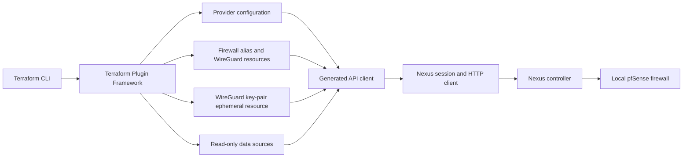

# 🏗️ Architecture

## 🎯 Scope and status

This experimental Terraform provider manages a local pfSense firewall and
reads selected configuration through the Nexus controller API. Its provider
source is `geo-gaussian/pfsense-nexus`; the local Terraform provider name is
`pfsense`. It currently offers:

- `pfsense_firewall_alias`: create, read, update, delete, and import an alias.
- `pfsense_firewall_aliases`: read user-defined alias metadata without changing
  aliases or reloading the firewall.
- `pfsense_wireguard_settings`: manage the global WireGuard settings singleton.
- `pfsense_wireguard_tunnel` and `pfsense_wireguard_peer`: manage WireGuard
  tunnels and peers, including import.
- `pfsense_wireguard_key_pair`: generate a transient WireGuard key pair using
  Terraform's ephemeral resource support (Terraform 1.10 or later).
- Read-only JSON data sources for firewall NAT rules, firewall interfaces and
  rules, schedules, traffic shapers, ALTQ queues and limiters, interface
  assignments and discovery, bridge/tunnel/VLAN interface types, static routes,
  gateways, alias metadata, selected service configuration and status, VPN
  configuration and status, and system health and discovery.

Login and alias listing have been exercised on one appliance. Alias writes and
reloads, WireGuard operations and key generation, and read-only data sources
other than alias listing have only been tested against mock servers. Appliance
compatibility remains unverified. Do not use write resources on a production
firewall until they have been validated in an isolated environment.

## 🧩 Components

| Component | Responsibility |
| --- | --- |
| [main.go](main.go) | Starts the provider server and exposes its version. |
| [internal/provider/provider.go](internal/provider/provider.go) | Defines configuration, registers resources and data sources, and supplies their API client. |
| [Alias resource](internal/provider/resource_firewall_alias/firewall_alias_resource.go) | Maps Terraform state and plans to API requests, handles import and missing aliases, and initiates firewall reloads. |
| [Aliases data source](internal/provider/data_firewall_aliases/firewall_aliases_data_source.go) | Reads alias metadata and reports missing or invalid responses. |
| [WireGuard resources](internal/provider/resource_wireguard/wireguard_resources.go) | Implements custom lifecycle and import behaviour for WireGuard settings, tunnels, and peers. |
| [WireGuard ephemeral resource](internal/provider/ephemeral_wireguard/key_pair.go) | Generates a transient key pair through the Nexus API. |
| [Read-only data sources](internal/provider/data_readonly) | Reads selected firewall, network, service, VPN, and system configuration or status; returns the API payload as JSON, with sensitive outputs marked or projected safely. |
| [internal/api/client_gen.go](internal/api/client_gen.go) | Generated API types, request builders, and response parsers. |
| [internal/client/client.go](internal/client/client.go) | Validates the controller URL, manages authentication, and serialises HTTP requests. |

Terraform communicates with the provider using the Plugin Framework. The
Registry manifest declares protocol version 6. The provider creates an API
client for `/api/device/pfsense/localhost/api`, assuming the local firewall is
registered as `localhost`. That routing assumption has not been verified across
other installations.

## 🔐 Authentication and request flow

The provider requires an HTTPS origin, username, and password. TLS verification
is enabled by default; `insecure` disables certificate verification and is for
isolated tests only. The password is marked sensitive, but Terraform state and
saved plans can still contain sensitive information and must be protected.

Authentication is lazy: the first API operation logs in through
`/api/login`, and later operations refresh the session through
`/api/login/refresh` when renewal is due. The client maintains a cookie jar and
sends the access token as a bearer token. A plan for a new resource does not
necessarily contact the controller.

All HTTP calls, including login and refresh, pass through `NexusClient.DoRequest`.
Locks serialise session handling and individual HTTP requests for a configured
client. They do not make a whole CRUD operation atomic, coordinate separate
provider configurations or Terraform processes, or prevent external changes.

## 🔄 Alias lifecycle

The alias name is the Terraform identity and import identifier; changing it
requires replacement. The resource uses `PUT /aliases` to create,
`GET /aliases/{id}` to read, `POST /aliases/{id}` to update, and
`DELETE /aliases/{id}` to delete.

After a successful write, the provider initiates a filter reload with
`POST /system/filterreload/reload` and reads the alias to verify its state, or
its absence after deletion. It does **not** wait for reload completion or
prove that the rules are active.
If a write or reload fails, inspect the firewall and reload manually before
retrying; state refresh may observe the change without retrying the reload.
An uncertain create response may require importing the existing alias.

A read removes the resource from Terraform state when the API confirms the
alias is absent. If the API returns HTTP 400, the provider checks the alias
list before treating it as absent. It rejects truncated alias details rather
than saving incomplete resource state. The alias data source returns metadata
only; an omitted alias list produces a warning and null, rather than an empty
list.

## 🔐 WireGuard lifecycle

The settings resource manages a singleton and has no API delete operation;
destroying it relinquishes Terraform management without resetting firewall
settings. Tunnel and peer resources support create, read, update, delete, and
import. Secret values are marked sensitive and retained from prior state when
the API masks them during reads. Key generation is exposed as an ephemeral
resource so generated values are not persisted by that resource.

The included OpenAPI specification has no WireGuard-specific apply or reload
operation, so WireGuard mutations use the documented operations without an
additional apply call. The WireGuard endpoints and writes are mock-tested but
have not been validated against a live appliance.

## 🔍 Read-only data sources

Read-only data sources expose selected API payloads as computed JSON strings
for callers to inspect with Terraform's `jsondecode()`. They include firewall,
network, service, VPN, and system configuration or status, but exclude
diagnostic actions and downloads. Outputs that may contain arbitrary or
identifying configuration are marked sensitive. The WireGuard status source
omits private keys, preshared keys, and configuration objects.

## ⚙️ Generation and development

[docs/nexus.openapi.yaml](docs/nexus.openapi.yaml) is the included Netgate API
specification. `make generate` uses [generator_config.yaml](generator_config.yaml)
to generate schemas for the mapped firewall resources and
[oapi-codegen.yaml](oapi-codegen.yaml) to generate the Go API client methods
selected for resources and data sources.
The generated `*_gen.go` files are not hand-edited; CRUD, authentication,
reload handling, and Terraform data-source behaviour are custom code. WireGuard
mutations use the documented operations without an additional apply call,
because the current specification defines no WireGuard-specific reload
operation. Review generated changes alongside custom integration when updating
the specification.

Tests use mock HTTP servers; when Terraform is available, tests also exercise
the provider protocol. The installed pre-commit hook checks staged code sizes,
then runs lint and tests on the working tree. CI runs build, lint, and tests in
parallel; the default-branch ruleset requires the lint job. Live acceptance
tests are not yet implemented and should use an isolated, disposable firewall
with test-only credentials. See [DEVELOPMENT.md](DEVELOPMENT.md) for the size
limits and checker scope.

## 📦 Release flow

The manual release workflow resolves an existing version tag to a commit and
reruns build, lint, and tests on that commit. After validation, it verifies the
tag still identifies the same commit. GoReleaser builds platform packages,
signs the checksums, and creates a draft GitHub release. A maintainer reviews
and publishes the draft. The provider must
be registered separately in the Terraform Registry; its webhook ingests
subsequent published releases. Release signing keys and passphrases are kept in
GitHub Actions secrets, not in the repository.

See the [README](README.md) for development, operational recovery, and release
instructions, and [Registry documentation](docs/index.md) for provider usage.
