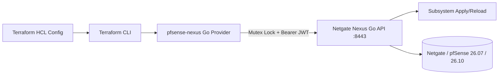

# 📋 Business Requirements Document (BRD): `pfsense-provider`

## 🎯 1. Executive Summary

This project delivers a custom, declarative Terraform provider (`pfsense-nexus`) built on HashiCorp's `terraform-plugin-framework` and generated from Netgate's official Go-based REST API (`nexus.openapi.yaml`). It enables full Infrastructure-as-Code (IaC) management of Netgate/pfSense appliances (version 26.07+ and unified 26.10+) without relying on legacy PHP web scraping or deprecated third-party PHP API packages.

## 🚨 2. Problem Statement & Business Drivers

- **Deprecation of Legacy Stack:** Netgate is retiring the legacy PHP web interface and PHP-based packages (`pfSense-pkg-RESTAPI`) starting with pfSense 26.10 in favor of its native Go controller and REST API.
- **Incomplete Community Tooling:** Existing community Terraform providers either scrape legacy HTML forms (lacking support for critical features like WireGuard tunnels/peers) or target the retiring PHP package. No official or community provider exists for Netgate's new Go API.
- **Operational Risk & Drift:** Manual configuration changes over months create undocumented configuration drift, slow disaster recovery, and risk human error during firewall or VPN updates.

## 🎯 3. Project Goals & Success Metrics

- **95%+ Configuration Coverage:** Manage core networking, firewalling, NAT, DNS, DHCP, and VPN subsystems declaratively via Terraform.
- **Zero-Downtime Safety:** Prevent race conditions on pfSense's configuration lock and protect management interfaces from accidental lockout.
- **Brownfield Import Capability:** Support `terraform plan -generate-config-out` to reverse-engineer existing router configurations into clean, secret-scrubbed HCL.
- **Automated Verification:** Achieve full offline unit test coverage (`httptest`) and automated acceptance testing (`TF_ACC=1`) against ephemeral pfSense 26.10 QEMU/KVM instances in GitHub Actions.

## 📦 4. Functional Scope

### ✅ 4.1 In-Scope Subsystems (Phase 1 — 95%+ Coverage)

| Subsystem          | Target Resources                                                       | Key Capabilities                                                    |
| :----------------- | :--------------------------------------------------------------------- | :------------------------------------------------------------------ |
| **Networking**     | `vlan`, `interface_assignment`, `static_route`, `gateway`              | VLAN tagging, routing tables, gateway monitoring                    |
| **Firewall & NAT** | `firewall_alias`, `firewall_rule`, `nat_port_forward`, `nat_outbound`  | Ordered rule management, host/network/port aliases, port forwarding |
| **VPNs**           | `wireguard_tunnel`, `wireguard_peer`, `ipsec_tunnel`, `openvpn_server` | Full tunnel and peer lifecycle, PSK/private key handling            |
| **Services**       | `dhcp_static_mapping`, `unbound_host_override`, `coredns`, `acme_cert` | Static IP reservations, internal DNS overrides, certificates        |
| **System**         | `user`, `system_tunable`                                               | Automation service accounts and kernel tunables                     |

### ❌ 4.2 Out-of-Scope (Remaining <5% Lifecycle Layer)

- Initial hardware/ZFS installation and serial console bootstrap.
- Out-of-band management interface IP and anti-lockout firewall rules (kept static to prevent API severance).
- Legacy third-party packages not yet migrated to Netgate's Go API (managed via scheduled `config.xml` backups).

## 🛡️ 5. Non-Functional & Security Requirements

- **Sequential API Execution:** All write requests (`POST`, `PUT`, `DELETE`) must be serialized using a Go `sync.Mutex` to prevent concurrent `config.xml`/backend commit collisions.
- **Secret Hygiene:** All private keys, pre-shared keys (PSKs), and passwords must be flagged `Sensitive: true` (and `WriteOnly: true` where applicable) in provider schemas, never logged in plaintext, and excluded from version control.
- **Idempotent Reloads:** Configuration changes requiring a subsystem reload (e.g., firewall filter reload or Unbound restart) must trigger the corresponding Nexus `/apply` endpoint automatically.
- **Architecture Flow:**

## 🗓️ 6. Milestones

1. **M1 — Foundation:** Download `nexus.openapi.yaml`, configure `generator_config.yml`, generate base Go code via `tfplugingen-openapi`, and implement `NexusClient` with JWT auth and `sync.Mutex`.
2. **M2 — Core Resources & Import:** Wire CRUD + `ImportState` for Firewall, VLANs, DNS/DHCP, and WireGuard; import existing 6-month router state into scrubbed HCL.
3. **M3 — CI/CD & Testing:** Implement offline `httptest` unit tests and GitHub Actions QEMU/KVM acceptance tests targeting pfSense 26.10.
