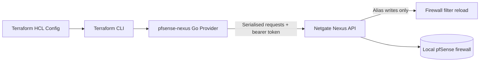

# 📋 Business Requirements Document (BRD): `pfsense-provider`

## 🎯 1. Executive Summary

This project aims to provide declarative Terraform management of pfSense
through Netgate's Nexus REST API. It uses HashiCorp's Terraform Plugin
Framework and code generated from the included OpenAPI specification. The
current experimental implementation includes firewall alias management,
WireGuard settings, tunnel and peer resources, ephemeral WireGuard key
generation, and selected read-only JSON data sources. Login and alias listing
have been tested on one appliance; writes, key generation, and read-only data
sources other than alias listing have only been tested with mock servers.
Broader resource coverage and compatibility with other appliance versions
remain goals, not established capabilities. See [README.md](README.md) for
verified status and safety limits.

## 🚨 2. Problem Statement & Business Drivers

- **Changing API surface:** A provider for the Nexus API can avoid reliance on
  web-interface automation or third-party API packages.
- **Tooling needs:** Declarative management and import are needed across
  networking, firewall, VPN, and service configurations.
- **Operational Risk & Drift:** Manual configuration changes over months create undocumented configuration drift, slow disaster recovery, and risk human error during firewall or VPN updates.

## 🎯 3. Project Goals & Success Metrics

These are future targets, not claims about the current implementation.

- **95%+ Configuration Coverage:** Manage core networking, firewalling, NAT, DNS, DHCP, and VPN subsystems declaratively via Terraform.
- **Operational Safety:** Reduce configuration races and protect management
  interfaces from accidental lockout; zero downtime is not guaranteed.
- **Brownfield Import Capability:** Support `terraform plan -generate-config-out` to reverse-engineer existing router configurations into clean, secret-scrubbed HCL.
- **Automated Verification:** Achieve full offline unit test coverage (`httptest`) and automated acceptance testing (`TF_ACC=1`) against ephemeral pfSense 26.10 QEMU/KVM instances in GitHub Actions.

## 📦 4. Functional Scope

### 📋 4.1 Current implementation

The provider's implemented capabilities are experimental. Managed writes, key
generation, and read-only data sources other than alias listing have only been
tested against mock servers; live compatibility beyond login and alias listing
has not been established.

| Subsystem | Current capability | Limitation |
| :--- | :--- | :--- |
| **Firewall** | Alias create, read, update, delete, and import; alias metadata; selected firewall and NAT data sources. | Writes and filter reloads are mock-tested only. |
| **Networking** | Read-only interface, gateway, and route data sources. | No managed network resources are implemented. |
| **VPN** | WireGuard settings, tunnel, and peer resources; ephemeral key generation; WireGuard, IPsec, and OpenVPN reads. | WireGuard writes and key generation are mock-tested only; other VPNs have no managed resources. |
| **Services and system** | Selected configuration, status, lease, and monitoring data sources. | Reads are mock-tested only. |

Read-only data sources return JSON and do not provide resource lifecycle
management. The API coverage badge measures mapped OpenAPI operations; it is
not the same as the future configuration-management coverage goal below.

### 🚀 4.2 Future resource-management targets

The following are proposed managed resources, not current provider
capabilities. WireGuard settings, tunnels, and peers, and firewall aliases are
already implemented experimentally.

| Subsystem | Proposed resources | Key capabilities |
| :--- | :--- | :--- |
| **Networking** | `vlan`, `interface_assignment`, `static_route`, `gateway` | VLAN tagging, routing tables, gateway monitoring |
| **Firewall and NAT** | `firewall_rule`, `nat_port_forward`, `nat_outbound` | Ordered rule management and port forwarding |
| **VPNs** | `ipsec_tunnel`, `openvpn_server` | Full tunnel lifecycle and secret handling |
| **Services** | `dhcp_static_mapping`, `unbound_host_override`, `coredns`, `acme_cert` | Static IP reservations, internal DNS overrides, certificates |
| **System** | `user`, `system_tunable` | Automation service accounts and kernel tunables |

### ❌ 4.3 Out-of-scope targets

- Initial hardware/ZFS installation and serial console bootstrap.
- Out-of-band management interface IP and anti-lockout firewall rules (kept static to prevent API severance).
- Legacy third-party packages not yet migrated to Netgate's Go API (managed via scheduled `config.xml` backups).

## 🛡️ 5. Non-Functional & Security Requirements

- **Sequential API Execution:** Requests through each configured client must
  be serialised to reduce backend commit collisions. This does not coordinate
  other clients or processes.
- **Secret Hygiene:** All private keys, pre-shared keys (PSKs), and passwords must be flagged `Sensitive: true` (and `WriteOnly: true` where applicable) in provider schemas, never logged in plaintext, and excluded from version control.
- **Reloads:** Configuration changes requiring activation must trigger the
  relevant reload or apply operation. The current alias resource initiates a
  filter reload but does not confirm completion. The bundled OpenAPI
  specification defines no WireGuard-specific apply or reload operation.
- **Architecture Flow:**

## 🗓️ 6. Milestones

1. **M1 — Foundation:** API specification, generation, session handling, and
   serialised requests are implemented.
2. **M2 — Core Resources and Import:** Alias and WireGuard CRUD/import are
   experimental; the other proposed resources remain future work.
3. **M3 — CI/CD & Testing:** Offline mock tests and CI are implemented.
   Live acceptance tests against an isolated pfSense instance are future work.
