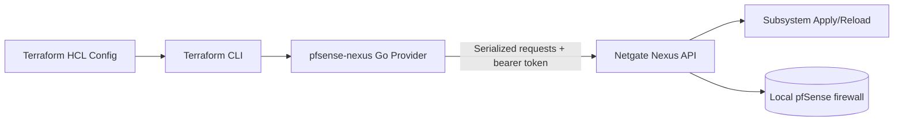

# 📋 Business Requirements Document (BRD): `pfsense-provider`

## 🎯 1. Executive Summary

This project aims to provide declarative Terraform management of pfSense
through Netgate's Nexus REST API. It uses HashiCorp's Terraform Plugin
Framework and code generated from the included OpenAPI specification. The
current experimental implementation supports firewall aliases and a read-only
alias metadata data source; broader coverage and version compatibility are
goals, not established capabilities. See [README.md](README.md) for the
verified status and safety limits.

## 🚨 2. Problem Statement & Business Drivers

- **Changing API surface:** A provider for the Nexus API can avoid reliance on
  web-interface automation or third-party API packages.
- **Tooling needs:** Declarative management and import are needed across
  networking, firewall, VPN, and service configurations.
- **Operational Risk & Drift:** Manual configuration changes over months create undocumented configuration drift, slow disaster recovery, and risk human error during firewall or VPN updates.

## 🎯 3. Project Goals & Success Metrics

These are future targets, not claims about the current implementation.

- **95%+ Configuration Coverage:** Manage core networking, firewalling, NAT, DNS, DHCP, and VPN subsystems declaratively via Terraform.
- **Operational Safety:** Reduce configuration races and protect management
  interfaces from accidental lockout; zero downtime is not guaranteed.
- **Brownfield Import Capability:** Support `terraform plan -generate-config-out` to reverse-engineer existing router configurations into clean, secret-scrubbed HCL.
- **Automated Verification:** Achieve full offline unit test coverage (`httptest`) and automated acceptance testing (`TF_ACC=1`) against ephemeral pfSense 26.10 QEMU/KVM instances in GitHub Actions.

## 📦 4. Functional Scope

### 📋 4.1 Target Subsystems (Phase 1 — 95%+ Coverage)

Only `firewall_alias` is currently implemented, and its write operations are
experimental. The remaining resources below are proposed.

| Subsystem          | Target Resources                                                       | Key Capabilities                                                    |
| :----------------- | :--------------------------------------------------------------------- | :------------------------------------------------------------------ |
| **Networking**     | `vlan`, `interface_assignment`, `static_route`, `gateway`              | VLAN tagging, routing tables, gateway monitoring                    |
| **Firewall & NAT** | `firewall_alias`, `firewall_rule`, `nat_port_forward`, `nat_outbound`  | Ordered rule management, host/network/port aliases, port forwarding |
| **VPNs**           | `wireguard_tunnel`, `wireguard_peer`, `ipsec_tunnel`, `openvpn_server` | Full tunnel and peer lifecycle, PSK/private key handling            |
| **Services**       | `dhcp_static_mapping`, `unbound_host_override`, `coredns`, `acme_cert` | Static IP reservations, internal DNS overrides, certificates        |
| **System**         | `user`, `system_tunable`                                               | Automation service accounts and kernel tunables                     |

### ❌ 4.2 Out-of-Scope Targets

- Initial hardware/ZFS installation and serial console bootstrap.
- Out-of-band management interface IP and anti-lockout firewall rules (kept static to prevent API severance).
- Legacy third-party packages not yet migrated to Netgate's Go API (managed via scheduled `config.xml` backups).

## 🛡️ 5. Non-Functional & Security Requirements

- **Sequential API Execution:** Requests through each configured client must
  be serialized to reduce backend commit collisions. This does not coordinate
  other clients or processes.
- **Secret Hygiene:** All private keys, pre-shared keys (PSKs), and passwords must be flagged `Sensitive: true` (and `WriteOnly: true` where applicable) in provider schemas, never logged in plaintext, and excluded from version control.
- **Reloads:** Configuration changes requiring activation must trigger the
  relevant reload or apply operation. The current alias resource initiates a
  filter reload but does not confirm completion.
- **Architecture Flow:**

## 🗓️ 6. Milestones

1. **M1 — Foundation:** API specification, generation, session handling, and
   serialized requests are implemented.
2. **M2 — Core Resources & Import:** Alias CRUD and import are experimental;
   the other proposed resources and broader import workflows remain future work.
3. **M3 — CI/CD & Testing:** Offline mock tests and CI are implemented.
   Live acceptance tests against an isolated pfSense instance are future work.
