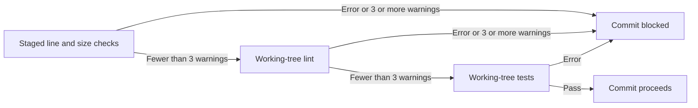

# 🧠 Development Playbooks

These project playbooks supplement [AGENTS.md](AGENTS.md); they are not Spec
Kit agent skills. Spec Kit's installed skills live in `.github/skills/`.

## 🧩 Keeping programs in standalone files

Put programs in files written in their own language, including Terraform test
fixtures. Supply changing values through arguments, environment variables, or
the language's configuration variables instead of building source strings.
Use standalone files for interpreter, AWK, sed, and jq programs; the same rule
applies to agent terminal commands and workflow automation. Ordinary commands
and their arguments remain inline. See [AGENTS.md](AGENTS.md) for the approved
Spec Kit script exemption and the approval requirement for any other exception.

`pnpm run lint:inline` checks common interpreter and filter invocations in
shell scripts, package scripts, Makefiles, and workflows; multiline workflow
blocks; and Terraform configuration in Go raw strings. It skips the existing
Spec Kit-managed shell scripts explicitly listed in the checker, documentation,
and generated Go files. Update that list when managed scripts change; do not
add project-owned scripts to it. This is a targeted safeguard,
not a parser for every language or a guarantee that all embedded programs are
detected. Review changes manually, including other string forms and subprocess
argument lists.

## 📏 Keeping code maintainable

Hand-written Go, JavaScript, TypeScript, POSIX shell, and jq source and tests
must not exceed 120 Unicode characters per physical line. Tabs count as one
character; CRLF line endings do not count towards the length. The check covers
`.go`, `.js`, `.jsx`, `.mjs`, `.cjs`, `.ts`, `.tsx`, `.mts`, `.cts`, `.sh`,
and `.jq` files, as well as files under `.githooks/`.

Generated Go and marked JavaScript or TypeScript files, fixture directories,
and Spec Kit-managed scripts are excluded. The hand-written
[`evidence.go`](tools/coverage/evidence.go) is the approved exception: its
operation mappings are retained as a readable, sorted table. Other source files
have no line-length exceptions.

`pnpm run lint:lines` checks the working tree; `pnpm run lint:lines:staged`
checks the Git index. The installed pre-commit hook runs both, and CI runs the
working-tree check. Lines above the limit block commits and merges.
`.editorconfig` provides editor guidance; the checker enforces the rule.
Prettier retains its existing 80-column formatting target.

The constitution and [AGENTS.md](AGENTS.md) define these physical-line limits.
Individual warnings are non-blocking; errors always block commits and merges.
The aggregate warning budget described below also blocks them at three warnings.

| Scope | Warning above | Error above |
| --- | ---: | ---: |
| Production file | 350 | 500 |
| Production function | 40 | 80 |
| Test file | 500 | 600 |
| Test function, including helpers | 100 | 150 |

Comments and blank lines count. Function lengths run from the declaration
through the end of the definition, including nested closures; nested functions
are also checked individually. A value equal to a limit does not exceed it.

`pnpm run lint:size` checks Go, TypeScript, JavaScript, and POSIX shell files
and functions, and jq file sizes. Go `_test.go` files and JavaScript or
TypeScript `.test` and `.spec` files use the test limits. Shell and jq files
use production limits. The shell check parses POSIX syntax; it is not a
complete portability or shebang check.

The checker skips generated Go files and TypeScript or JavaScript files marked
with the supported generated-code header. It also skips Spec Kit-managed
scripts and the repository's fixture directories. Lockfiles and API
specifications are outside its source-file scope. These exclusions apply to
size checks only: other lint and project rules still apply to fixtures.
Any exception for hand-written code must identify the specific file or
function, explain why it is needed, and receive reviewer approval. The checker
does not provide a general suppression mechanism; an exception also requires a
reviewed checker change.

The five-line [`current-commit-sha.jq`](scripts/current-commit-sha.jq) filter
has no functions; jq function sizes are not checked automatically. Review any
added jq functions manually until jq parsing is supported. Spec Kit-managed
scripts are excluded because they are maintained upstream.

### 🚦 Lint warning budget

`pnpm run lint` fails when its lint commands collectively emit three or more
warnings, even if each individual command succeeds. It preserves their output
and still fails on any command error. In GitHub Actions it also emits an error
annotation when the budget is exceeded. The lint job is required for merging.

The budget recognises GitHub `::warning` annotations and warning-labelled text
such as `warning:`, `[warn]`, `file: warning:`, and `npm WARN`, on either output
stream. It also recognises runtime warning types such as `DeprecationWarning`
and line-and-column diagnostics. New lint tools must use a recognised format or
provide an adapter and tests: unlabelled messages cannot reliably be identified
as warnings. Warnings from workflow setup actions outside the lint command are
not included.

`pnpm run lint:staged` applies the same budget to staged line and size checks.
The pre-commit hook runs it and then runs `pnpm run lint` on the working tree;
the two counts are separate, so the same finding is not counted twice. Direct
individual checks, including `pnpm run lint:size`, report findings without
applying the aggregate budget.

In GitHub Actions, size findings appear as warning or error annotations matching
their threshold. Locally, findings are printed as plain text.



`pnpm run lint:size` checks tracked and non-ignored untracked files in the
working tree. The installed pre-commit hook also runs
`pnpm run lint:staged` against the Git index, so an unstaged edit cannot
conceal an oversized staged file. The hook then runs the full lint and test
commands on the working tree; unstaged changes can therefore also block a
commit. Run `pnpm run setup-hooks` after cloning to install the hook. The CI
lint job runs the working-tree checks, and the default-branch ruleset requires
that job to pass before merging.

## 🔌 Adding a New Resource via `tfplugingen-openapi`

1. Locate the target operations and methods in `docs/nexus.openapi.yaml`.
2. Add the mapping under `resources:` in `generator_config.yaml`, and include
   the necessary operation IDs in `oapi-codegen.yaml`. Use the existing alias
   mapping as an example; methods and paths vary by endpoint.
3. Run `make generate`, which uses the repository's pinned generator versions.
   The HashiCorp mapping generates schemas for the mapped firewall resources;
   their lifecycle code, read-only data sources, and WireGuard resources use
   custom Terraform Framework code. Review generated changes and preserve
   custom resource lifecycle code and registration.
4. Implement the lifecycle and import methods, register the resource in
   `internal/provider/provider.go`, and test its behaviour with mock servers.
   Trigger the appropriate reload or apply operation when required.
5. Add focused tests for successful behaviour and relevant validation, API
   failures, malformed responses, and state-preservation behaviour. Run
   `pnpm run coverage`, compare coverage with the base revision, and run
   `pnpm run lint`.

## 🔍 Adding a Read-Only Data Source

1. Confirm the OpenAPI operation is a safe read. An HTTP `GET` can still
   generate credentials or trigger an action; exclude those operations. Review
   the full response schema for keys, passwords, tokens, private network data,
   and arbitrary user-provided configuration.
2. Add the operation ID to `oapi-codegen.yaml` and run `make generate` to update
   the generated API client. The Terraform data-source implementation itself
   is custom code, not generated by the HashiCorp data-source generator.
3. Implement the source under `internal/provider/data_readonly` using the
   shared helpers, register it in `internal/provider/provider.go`, and add its
   page under `docs/data-sources/`.
4. Mark the `json` output sensitive when the response can contain private or
   identifying information. If secret fields can be safely omitted from a
   status projection, omit them rather than exposing them in state.
5. Add mock HTTP coverage for successful responses and relevant failure cases.
   Run `pnpm run coverage`, compare coverage with the base revision, and run
   `pnpm run lint`.

## 🔐 WireGuard resources and ephemeral keys

The WireGuard settings, tunnel, and peer resources are custom Terraform
Framework implementations. Tunnel private and peer preshared keys are
sensitive, optional and computed, not Terraform write-only attributes. They can
remain in state and are retained from prior state when GET responses omit them
or return empty values. Protect state and saved plans.
WireGuard key generation is an action exposed as an ephemeral resource, not a
repeatable data source. Use `NexusClient.DoRequest` for every API operation;
the OpenAPI contract currently defines no WireGuard-specific apply endpoint.

## 📥 Implementing `ImportState` for Brownfield HCL Generation

Every resource must implement `resource.ResourceWithImportState`. An import
block and `terraform plan -generate-config-out=...` can help generate
configuration for supported resources; review generated output for secrets:

```go
func (r *exampleResource) ImportState(ctx context.Context, req resource.ImportStateRequest, resp *resource.ImportStateResponse) {
  resource.ImportStatePassthroughID(ctx, path.Root("id"), req, resp)
}
```

Replace `"id"` with the actual state attribute used as the import identifier.
For example, the alias resource imports by `name`.

## 🔒 Preventing Secret Wipeouts on `Read()`

When Netgate's API omits secrets (such as WireGuard `privatekey`) from `GET`
responses or returns an empty value, preserve prior state:

```go
if apiResp.PrivateKey != "" {
  state.PrivateKey = types.StringValue(apiResp.PrivateKey)
}
// Otherwise keep state.PrivateKey untouched from req.State.Get(ctx, &state)
```

## 🧪 Offline HTTP Unit Testing with `httptest`

Test JSON serialisation, authentication, and HTTP errors without needing a live
router. See `internal/client/client_test.go` and the existing resource and data
source tests for the current request paths and mock-server patterns.

## 📊 Preventing Coverage Regressions

Run the same coverage command on the base revision and the proposed change:

```sh
pnpm run coverage
```

Compare the reported unit statement-coverage ratios, using the same toolchain
and coverage rules. When the covered or total statement counts differ, compare
the ratios rather than the covered counts alone. The command runs the
race-enabled Go test suite and generates the report, but it does not fail when
coverage decreases.

The proposed change MUST NOT lower coverage without a clear justification in
the pull request and explicit reviewer approval. Explain the reason for the
decrease, its impact, and any mitigating tests or safeguards. Report the
before-and-after coverage values; a successful command exit is not evidence
that coverage did not regress.

Add focused tests for changed behaviour, including applicable success,
validation, API transport and status errors, malformed or missing responses,
secret retention, and out-of-band deletion. Assert outcomes and diagnostics;
do not optimise tests for line execution or remove coverage exclusions to hide
a regression. When a defensive conversion error cannot be triggered with valid
Terraform input, isolate the conversion boundary so its error handling can be
tested without weakening production checks.

## 🧭 Spec Kit Test Requirements

Spec Kit provides a project Constitution and a Constitution Check in the
implementation-plan workflow. The repository Constitution makes focused tests
mandatory for behaviour changes and requires plans to include test tasks, even
though the generic Spec Kit tasks template describes tests as optional. Each
story's independent test and acceptance scenarios should identify the expected
behaviour and relevant failure cases.

## 🖥️ Planning live acceptance tests

Live acceptance tests and an appliance provisioning workflow are not yet
implemented. Use an isolated, disposable pfSense environment and test-only
credentials when adding them. Do not expose credentials or the appliance to
untrusted pull request code. Validate image availability, networking, and
runner support before choosing a virtualisation approach.
